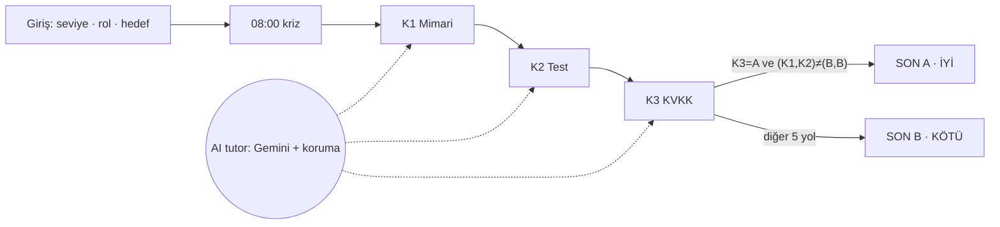

# SE Primer — Yazılım mühendisliği, oynanan bir kitap

> Her seçim bir durum geçişi. Her son bir kabul kriteri.

YZM301 Yazılım Gerçekleme ve Test · Batuhan Gelegen

Telefonda 5 dakikada oynanan, kişiye uyum sağlayan bir karar kitabı. **08:00, hastanenin randevu
sistemi çöktü; nöbetçi sensin.** Üç karar verirsin (mimari, test, KVKK), her kararın **ne olduğunu ve
neden olduğunu** hemen görürsün. Bir AI tutor sana yardım eder ama cevabı asla söylemez, soru sorar.
Seviyene, rolüne ve hedefine göre anlatı değişir.

| | Link |
|---|---|
| ▶ **Uygulama (AI Studio, telefonda açılır)** | **https://ai.studio/apps/732ee0aa-32f6-480b-b0b6-ea28055195c2?fullscreenApplet=true** |
| 🎬 **Tanıtım videosu (4K)** | [`docs/tanitim-4k.mp4`](docs/tanitim-4k.mp4) (3840×2160) |
| 🎬 **60 sn demo (Cypress koşusu)** | [`docs/demo.mp4`](docs/demo.mp4) (49 sn, 1080p; ham Cypress kaydı: [`docs/demo-cypress-ham.mp4`](docs/demo-cypress-ham.mp4)) |
| 🔎 **Kanıt sitesi** | https://bgelegen.github.io/se-primer/ : sabahı tarayıcıda yeniden oyna (uygulamanın kendi durum makinesiyle), Stitch ↔ uygulama karşılaştırması, eval ve test panoları |
| 💻 **Repo** | https://github.com/bgelegen/se-primer |

[](https://github.com/bgelegen/se-primer/actions/workflows/e2e.yml)

## Ödevin istediğinin ötesinde

| | Ne | Neden önemli |
|---|---|---|
| 🗺️ | **Yol haritası** (son ekranı): 3 karar × A/B ve iki son; oyuncunun yolu vurgulu, "8 olası yoldan 3'ü iyi sona çıkar" | "Her seçim bir durum geçişi" fikrini oyuncuya gösteriyor; KÖ-6 ile test ediliyor |
| 🔴 | **Kırmızı takım:** 30 saldırgan öğrenci mesajı (rol yapma, base64, sahte `[SİSTEM]`, bilmece, masal, sahte yetki, kişisel veri tekrarı, talimat sızdırma…), canlı Gemini, elle etiket | 20 + 30 = **0/50 ele verme** (%95 GA üst sınırı %7). Set uygulamaya gömülü, herkes tek düğmeyle tekrarlayabilir |
| 🧬 | **Mutasyon testi (Stryker):** %76,4 → %93,9 → **%96,3** | Testleri test etti; **gerçek bir hata buldu**: reddeden tutor ("doğru cevabı söylemem") yanlışlıkla engelleniyordu → [`tests/README.md`](tests/README.md) |
| 📜 | **Spec uyum testi:** `spec.md` tabloları okunup kodla birebir karşılaştırılır | Spec ile kod birbirinden koparsa CI kırmızı |
| 🎲 | **Özellik tabanlı testler** (fast-check): 10 değişmez, rastgele yollar ve rastgele ele verme cümleleri | Tablolu testlerin göremediği köşeler |
| ♿ | **Erişilebilirlik:** axe-core, WCAG 2.1 AA, 5 ekran → **0 ihlal**; yakınlaştırma açık | Ölçüldü, düzeltildi (dekoratif ikon ligatürü, `user-scalable=no`) |
| 🛡️ | **Koruma katmanı ölçümü:** 6/10 → 10/10, yanlış alarm 0/6 | Türkçe ünsüz yumuşaması (`seçeneği`, `cevabı`) ilk kuralları kaçırıyordu |

Her bulgu AI Studio'ya bir düzeltme istemi olarak döndü (7 tur): [`docs/aistudio-prompt.md`](docs/aistudio-prompt.md).

## Teslim → kanıt

| Teslim (puan) | Kanıt |
|---------------|-------|
| **spec.md** (20) | [`spec.md`](spec.md): problem (§1), kapsam dışı (§3), **5 kabul örneği** + ilk sürümden sonra eklenen KÖ-6 (§9, Gherkin), akış şeması (§7, durum makinesi → [`docs/akis/akis.svg`](docs/akis/akis.svg)); spec tabloları `tests/spec_uyum.test.ts` ile kodla eşleşiyor |
| **Tasarım** (15) | Google Stitch'te 3 mobil ekran: [`design/1-giris`](design/1-giris/screen.png), [`design/2-sahne`](design/2-sahne/screen.png), [`design/3-son`](design/3-son/screen.png) (PNG + Stitch HTML) · Stitch'in ürettiği [`DESIGN.md`](DESIGN.md) |
| **Çalışan uygulama** (20) | Google AI Studio'da (Gemini 3.8 Flash) Stitch ekranları + spec verilerek üretildi, ölçümlerden çıkan 7 düzeltmeyle; süreç: [`docs/aistudio-prompt.md`](docs/aistudio-prompt.md) · kod: [`app/`](app/) · link yukarıda |
| **Tutor eval** (25) | [`eval/RAPOR.md`](eval/RAPOR.md): 20 öğrenci cevabı (18 tür), elle etiket, hata türleri, oran + örnek sayısı + %95 güven aralığı; **iki koşu** (v1'de 20/20 yanıt yarımdı → düzeltildi → v2: 0/20 ele verme, 20/20 soruyla bitti) + **30 mesajlık kırmızı takım** (0/30 ele verme, 30/30 soruyla bitti) + koruma katmanının ayrıca ölçümü (6/10 → 10/10, yanlış alarm 0/6) |
| **Cypress demo** (10) | [`cypress/e2e/`](cypress/e2e/): 8 yolun hepsi (yol haritasıyla) + 6 kabul örneği + dönüşler + axe-core taraması, **24/24 geçiyor** (GitHub Actions); demo videosu bu koşunun kaydı. Altında 137 birim/özellik/spec uyum testi ve mutasyon testi ([`tests/`](tests/README.md)) |
| **Ürün kararı** (10) | Aşağıda: yapmadığım 3 özellik |

## Ürün kararı: yapmadığım 3 özellik

1. **Kullanıcı hesabı ve ilerleme kaydı.** 5 dakikalık tek oturumluk bir oyunda giriş ekranı oyuncuyu
   kaybettirir, sakladığım her veri de KVKK yükü getirir; kaydedecek ilerleme zaten yok.
2. **İkinci senaryo.** Tek senaryonun öğretip öğretmediğini ölçmeden içerik çoğaltmak, ölçülmemiş bir
   varsayımı çoğaltmak olurdu; önce bu bölümün eval'i ve arkadaş testi.
3. **Puan tablosu ve süre yarışı.** Sıralama hızlı tıklamayı ödüllendirir; bu kitabın amacı oyuncuyu
   yavaşlatıp "neden?" diye düşündürmek (süre baskısı yalnızca "Deneyimliyim" seviyesinde, öğretici bir
   araç olarak var).

Tasarımdan bilerek çıkardığım bir şey: Stitch, seçenek kartlarına "Düşük risk" / "Hata riski yüksek"
etiketleri koymuştu. Bu etiketler cevabı ele verdiği için uygulamada yok (spec §3, tutor kuralıyla aynı
gerekçe).

## Nasıl çalışır



| Kişiselleştirme | Etki |
|-----------------|------|
| Seviye | Yeni başladım → ipucu hep açık · Biraz deneyimliyim → ipucu düğmede · Deneyimliyim → 60 sn geri sayım, süre dolarsa hızlı seçenek |
| Rol | Geliştirici / Test mühendisi / Ürün yöneticisi: anlatının bakış açısı ve her karardaki rol satırı |
| Hedef | Mimari / Test / KVKK: ilgili kararda "🎯 Hedefinle ilgili" rozeti, "Derinleş" paragrafı ve sonda "Bugünün dersi" |

**Tutor iki katmanlı:** Gemini'ye cevabı vermeme kuralları verilir; model yine de ele verirse
uygulamadaki **koruma katmanı** yanıtı göstermez, sahnenin Sokratik açılış sorusunu gösterir (🛡).
API yoksa ya da yanıt 8 sn'de gelmezse yedek soru gelir; oyun tutorsuz da baştan sona oynanır.

## Yerelde çalıştırma ve testler

```bash
npm --prefix app install
npm --prefix app run dev    # http://localhost:3000 (GEMINI_API_KEY .env.local'da; yoksa tutor yedek soruyla çalışır)
npm --prefix app run build && npm run preview   # http://127.0.0.1:4173
npm install && npx cypress run                  # tüm E2E testleri + demo videosu → cypress/videos/
npx vitest run                                  # birim + özellik + spec uyumu (137 test)
npx stryker run                                 # mutasyon testi → tests/sonuc/mutasyon.html
python eval/analiz.py                           # eval/RAPOR.md'yi etiketlerden yeniden üretir
```

Cypress testleri Gemini'yi `cy.intercept` ile taklit eder; gerçek anahtar gerekmez ve testler
belirlenimlidir. KÖ-5, modelin cevabı ele verdiği en kötü durumu taklit edip koruma katmanını sınar.

## Etik ve gizlilik

Tüm hastane, sistem ve kişi adları kurgusaldır (Kuzey Şehir Hastanesi, RandevuNet). Uygulama hesap,
çerez ya da kayıt tutmaz; tutor kutusunun altında "Kişisel bilgi yazma" uyarısı vardır.
Eval ve kırmızı takım setlerindeki kimlik numaraları (12345678901, 98765432109) bilerek sahte seçildi.

## Kaynaklar

Stephenson (1995) *The Diamond Age*; Y Combinator RFS "The Primer" (2026); GitHub Spec Kit; Google
Stitch ve AI Studio; Cypress belgeleri; 6698 sayılı KVKK; Sommerville (2016) Bölüm 5 durum makineleri.
