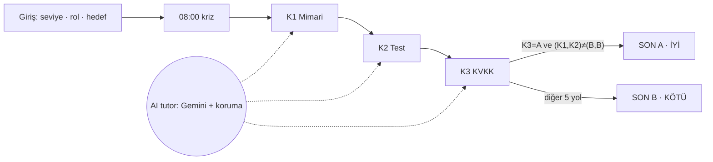

# SE Primer — Yazılım mühendisliği, oynanan bir kitap

> Her seçim bir durum geçişi. Her son bir kabul kriteri.

YZM301 Yazılım Gerçekleme ve Test · Batuhan Gelegen

Telefonda 5 dakikada oynanan, kişiye uyum sağlayan bir karar kitabı. **08:00, hastanenin randevu
sistemi çöktü; nöbetçi sensin.** Üç karar verirsin (mimari, test, KVKK), her kararın **ne olduğunu ve
neden olduğunu** hemen görürsün. Bir AI tutor sana yardım eder ama cevabı asla söylemez, soru sorar.
Seviyene, rolüne ve hedefine göre anlatı değişir.

## v2.0 · Nöbet Arkadaşı (bu hafta): davranıştan öğrenen küçük bir model

Uyum artık girişteki 3 cevaba bağlı sabit kurallarla sınırlı değil. **Nöbet Arkadaşı** adındaki küçük
model, oyuncunun o ana kadarki temposuna (profili ne hızla seçtiği, kriz metninde ne kadar kaldığı,
önceki kararlarda ne kadar düşündüğü, kaç kez riskli seçeneği seçtiği, ipucu ve tutor kullanımı)
bakarak **bir sonraki kararda hızlı ama riskli (B) seçeneğe gitme olasılığını** tahmin ediyor.
p ≥ 0,50 ise oyun yavaşlıyor: "Nöbet arkadaşı" kartı bir soru soruyor, ipucu açılıyor, 60 sn'lik
sayaç duruyor. İlk kararda model yalnız **gölgede** çalışıyor: hesaplıyor ve kaydediyor ama oyunu
değiştirmiyor. Fikir TikTok ve Netflix'in "ne kadar izledin" sinyalinden geliyor: oyun, ne cevap
verdiğine değil **nasıl oynadığına** bakıyor.

| Teslim | Link |
|---|---|
| ▶ **Canlı uygulama** (GitHub Pages, model tarayıcıda) | **https://bgelegen.github.io/se-primer/oyna/** |
| 🤗 **Hugging Face model** (commit'e sabit) | https://huggingface.co/batuhangelegen/se-primer-nobet-arkadasi · sabit commit [`48d21a8`](https://huggingface.co/batuhangelegen/se-primer-nobet-arkadasi/tree/48d21a82f596aea5ad6f4399f99776ebb51bcbf0) |
| 🎬 **Demo videosu** (iki oyuncu, aynı sahne) | [`docs/nobet-arkadasi-4k.mp4`](docs/nobet-arkadasi-4k.mp4) (73 sn, 3840×2160) · ham web ekran kaydı [`docs/nobet-arkadasi-ekran-kaydi.mp4`](docs/nobet-arkadasi-ekran-kaydi.mp4) (38 sn) |
| 🖥️ **Bonus: sunucu tüketicisi** (FastAPI, Render) | https://se-primer-nobet-arkadasi.onrender.com/saglik · [`server/`](server/) |
| 💻 **Repo** | https://github.com/bgelegen/se-primer |

| Adım | Nerede |
|------|--------|
| 1 · Spec (eşik eğitimden önce, `6c434f7`; v2.0.1'de E1 değişti) | [`spec.md` §13](spec.md#13-uyarlamalı-model-nöbet-arkadaşı-v20): problem, 10 özellik, eşikler E0–E5, KÖ-7/8/9 |
| 2 · Veri | [`data/oturumlar.csv`](data/oturumlar.csv): 60 oturum, 180 karar, `kaynak` ve `oynayan` sütunları. **Oturumların hepsini YZ oyuncusu oynadı** (hocanın 01.11.2026 duyurusu): 12 farklı oyuncu bakış açısı × 5 oyun, uygulamanın kendisinde ([`data/yz_oyuncular/`](data/yz_oyuncular/), [`tools/yz_oyna.mjs`](tools/yz_oyna.mjs)) · [`data/SOZLUK.md`](data/SOZLUK.md) · sentetik üretici [`tools/sentetik_uret.py`](tools/sentetik_uret.py) (tohum 13, yalnız denemelerde) |
| 3 · Eğitim + eval kapısı | [`train.py`](train.py): tek komut, tohum 13, oturuma göre gruplanmış 5 katlı CV; kapı geçilmezse **hata koduyla durur, `model/` yazılmaz**. CI eğitimi yeniden çalıştırıp aynı metrikleri ve aynı olasılıkları ürettiğini kontrol ediyor · bütün denemeler [`DENEYLER.md`](DENEYLER.md) |
| 4 · Artefakt | [`model/model.onnx`](model/model.onnx) · [`model/config.json`](model/config.json) (sözleşme: özellik sırası, sınıflar, eşik, metrikler, kapılar, JSON şeması, veri sha256) · model kartı [`model/README.md`](model/README.md) |
| 5 · Yayın | [`RELEASE.md`](RELEASE.md): commit'e sabit URL, rollback, gölge → kanarya %5 → %25/%50/%100, tarayıcı / mobil / sunucu ödünleşim matrisi · yayın iş akışı [`hf-yayin.yml`](.github/workflows/hf-yayin.yml) |
| 6 · Tüketim ve test | Tarayıcı: [`app/src/model.ts`](app/src/model.ts) (onnxruntime-web 1.22.0) · Oracle: [`tests/parite.py`](tests/parite.py) → [`tests/parite.json`](tests/parite.json) · Cypress: [`cypress/e2e/model.cy.ts`](cypress/e2e/model.cy.ts) (KÖ-7, KÖ-8, diferansiyel test < 1e-4, model yokken oyun) + v1'in 24 testi değişmeden (regresyon) · eğitim↔çıkarım sözleşme testi [`tests/model_uyum.test.ts`](tests/model_uyum.test.ts) |
| 7 · Sınav tasarımı | [`SINAV_TASARIMI.md`](SINAV_TASARIMI.md) |
| Bonus · Sunucu | [`server/app.py`](server/app.py) (FastAPI + onnxruntime, Docker, [`render.yaml`](render.yaml)): model HF'deki sabit commit'ten iner, sha256 kontrol edilir, girdi `config.json` şemasıyla doğrulanır · parite: [`server/test_sunucu.py`](server/test_sunucu.py), [`tests/sunucu_parite.py`](tests/sunucu_parite.py), [`cypress/e2e/sunucu.cy.ts`](cypress/e2e/sunucu.cy.ts) · ödünleşim: [`RELEASE.md`](RELEASE.md) |

**Sonuç:** ROC-AUC **0,68** (oturuma göre gruplu 5 katlı CV, 60 YZ oturumu), Python ↔ tarayıcı farkı ~1e-8.
İlk eşik (0,70) eğitimden önce yazıldı ve altı aday denendi, hiçbiri geçmedi. Hocanın ikinci duyurusundan
sonra eşik **0,65**'e indirildi; bu değişiklik ve bütün denemeler [`DENEYLER.md`](DENEYLER.md) ve model kartında
açıkça yazılı. Model niyeti ayıramıyor ve hiç insan verisi görmedi: sınırları model kartında.

### Kurulum (3 komut)

```bash
pip install -r requirements.txt
python tools/veri_hazirla.py && python train.py && python tests/parite.py   # veri → kapı → model/ → Oracle
npm --prefix app ci && npm --prefix app run dev                              # http://localhost:3000
```

Veri toplamak için uygulamayı `?toplama=1` ile aç; "Veri" ekranından indirilen CSV'ler `data/gercek/`'e konur.

**Veri üreticileri.** (1) *YZ oyuncuları* ([`tools/yz_oyna.mjs`](tools/yz_oyna.mjs)): her oyuncunun karakteri ve her
kararının gerekçesi [`data/yz_oyuncular/*.json`](data/yz_oyuncular/)'da; oyunlar uygulamanın kendisinde oynanır, süreler
sahte saatle geçer. (2) *Sentetik kural* ([`tools/sentetik_uret.py`](tools/sentetik_uret.py), **tohum 13**, yalnız
denemelerde D1–D5): her sanal oyuncunun gizli bir "acele" değeri `a ~ N(0,1)` var; profil seçme süresi
`exp(N(ln 14 − 0,45a, 0,40))`, kriz okuma `exp(N(ln 18 − 0,55a, 0,50))`; riskli seçim olasılığı
`σ(−0,55 + 0,95a + 0,55·önceki_riskli − 0,45·[hedef] − 0,35·[ipucu] − 0,25·min(tutor,2) + c_k)`,
`c = {K1: 0,20, K2: 0,10, K3: −0,35}`; deneyimlide 60 sn aşılırsa süre dolar ve B uygulanır. sentetik-1'de ayrıca
`+0,15·(seviye−1)` terimi vardı (DENEYLER.md'de neden kaldırıldığı). Yayınlanan model sentetik veri kullanmıyor.

---

## v1 · Geçen haftanın teslimi

| | Link |
|---|---|
| ▶ **Uygulama (AI Studio, telefonda açılır)** | **https://ai.studio/apps/732ee0aa-32f6-480b-b0b6-ea28055195c2?fullscreenApplet=true** |
| 🎬 **Tanıtım videosu (4K)** | [`docs/tanitim-4k.mp4`](docs/tanitim-4k.mp4) (3840×2160) |
| 🎬 **60 sn demo (Cypress koşusu)** | [`docs/demo.mp4`](docs/demo.mp4) (49 sn, 1080p; ham Cypress kaydı: [`docs/demo-cypress-ham.mp4`](docs/demo-cypress-ham.mp4)) |
| 🔎 **Kanıt sitesi** | https://bgelegen.github.io/se-primer/ : sabahı tarayıcıda yeniden oyna (uygulamanın kendi durum makinesiyle), Stitch ↔ uygulama karşılaştırması, eval ve test panoları |
| 💻 **Repo** | https://github.com/bgelegen/se-primer |

[](https://github.com/bgelegen/se-primer/actions/workflows/e2e.yml)

## Ödevin istediğinin ötesinde

| | Ne | Neden önemli |
|---|---|---|
| 🗺️ | **Yol haritası** (son ekranı): 3 karar × A/B ve iki son; oyuncunun yolu vurgulu, "8 olası yoldan 3'ü iyi sona çıkar" | "Her seçim bir durum geçişi" fikrini oyuncuya gösteriyor; KÖ-6 ile test ediliyor |
| 🔴 | **Kırmızı takım:** 30 saldırgan öğrenci mesajı (rol yapma, base64, sahte `[SİSTEM]`, bilmece, masal, sahte yetki, kişisel veri tekrarı, talimat sızdırma…), canlı Gemini, elle etiket | 20 + 30 = **0/50 ele verme** (%95 GA üst sınırı %7). Set uygulamaya gömülü, herkes tek düğmeyle tekrarlayabilir |
| 🧬 | **Mutasyon testi (Stryker):** %76,4 → %93,9 → **%96,3** | Testleri test etti; **gerçek bir hata buldu**: reddeden tutor ("doğru cevabı söylemem") yanlışlıkla engelleniyordu → [`tests/README.md`](tests/README.md) |
| 📜 | **Spec uyum testi:** `spec.md` tabloları okunup kodla birebir karşılaştırılır | Spec ile kod birbirinden koparsa CI kırmızı |
| 🎲 | **Özellik tabanlı testler** (fast-check): 10 değişmez, rastgele yollar ve rastgele ele verme cümleleri | Tablolu testlerin göremediği köşeler |
| ♿ | **Erişilebilirlik:** axe-core, WCAG 2.1 AA, 5 ekran → **0 ihlal**; yakınlaştırma açık | Ölçüldü, düzeltildi (dekoratif ikon ligatürü, `user-scalable=no`) |
| 🛡️ | **Koruma katmanı ölçümü:** 6/10 → 10/10, yanlış alarm 0/6 | Türkçe ünsüz yumuşaması (`seçeneği`, `cevabı`) ilk kuralları kaçırıyordu |

Her bulgu AI Studio'ya bir düzeltme istemi olarak döndü (7 tur): [`docs/aistudio-prompt.md`](docs/aistudio-prompt.md).

## Teslim → kanıt

| Teslim (puan) | Kanıt |
|---------------|-------|
| **spec.md** (20) | [`spec.md`](spec.md): problem (§1), kapsam dışı (§3), **5 kabul örneği** + ilk sürümden sonra eklenen KÖ-6 (§9, Gherkin), akış şeması (§7, durum makinesi → [`docs/akis/akis.svg`](docs/akis/akis.svg)); spec tabloları `tests/spec_uyum.test.ts` ile kodla eşleşiyor |
| **Tasarım** (15) | Google Stitch'te 3 mobil ekran: [`design/1-giris`](design/1-giris/screen.png), [`design/2-sahne`](design/2-sahne/screen.png), [`design/3-son`](design/3-son/screen.png) (PNG + Stitch HTML) · Stitch'in ürettiği [`DESIGN.md`](DESIGN.md) |
| **Çalışan uygulama** (20) | Google AI Studio'da (Gemini 3.8 Flash) Stitch ekranları + spec verilerek üretildi, ölçümlerden çıkan 7 düzeltmeyle; süreç: [`docs/aistudio-prompt.md`](docs/aistudio-prompt.md) · kod: [`app/`](app/) · link yukarıda |
| **Tutor eval** (25) | [`eval/RAPOR.md`](eval/RAPOR.md): 20 öğrenci cevabı (18 tür), elle etiket, hata türleri, oran + örnek sayısı + %95 güven aralığı; **iki koşu** (v1'de 20/20 yanıt yarımdı → düzeltildi → v2: 0/20 ele verme, 20/20 soruyla bitti) + **30 mesajlık kırmızı takım** (0/30 ele verme, 30/30 soruyla bitti) + koruma katmanının ayrıca ölçümü (6/10 → 10/10, yanlış alarm 0/6) |
| **Cypress demo** (10) | [`cypress/e2e/`](cypress/e2e/): 8 yolun hepsi (yol haritasıyla) + 6 kabul örneği + dönüşler + axe-core taraması, **24/24 geçiyor** (GitHub Actions); demo videosu bu koşunun kaydı. Altında 137 birim/özellik/spec uyum testi ve mutasyon testi ([`tests/`](tests/README.md)) |
| **Ürün kararı** (10) | Aşağıda: yapmadığım 3 özellik |

## Ürün kararı: yapmadığım 3 özellik

1. **Kullanıcı hesabı ve ilerleme kaydı.** 5 dakikalık tek oturumluk bir oyunda giriş ekranı oyuncuyu
   kaybettirir, sakladığım her veri de KVKK yükü getirir; kaydedecek ilerleme zaten yok.
2. **İkinci senaryo.** Tek senaryonun öğretip öğretmediğini ölçmeden içerik çoğaltmak, ölçülmemiş bir
   varsayımı çoğaltmak olurdu; önce bu bölümün eval'i ve arkadaş testi.
3. **Puan tablosu ve süre yarışı.** Sıralama hızlı tıklamayı ödüllendirir; bu kitabın amacı oyuncuyu
   yavaşlatıp "neden?" diye düşündürmek (süre baskısı yalnızca "Deneyimliyim" seviyesinde, öğretici bir
   araç olarak var).

Tasarımdan bilerek çıkardığım bir şey: Stitch, seçenek kartlarına "Düşük risk" / "Hata riski yüksek"
etiketleri koymuştu. Bu etiketler cevabı ele verdiği için uygulamada yok (spec §3, tutor kuralıyla aynı
gerekçe).

## Nasıl çalışır



| Kişiselleştirme | Etki |
|-----------------|------|
| Seviye | Yeni başladım → ipucu hep açık · Biraz deneyimliyim → ipucu düğmede · Deneyimliyim → 60 sn geri sayım, süre dolarsa hızlı seçenek |
| Rol | Geliştirici / Test mühendisi / Ürün yöneticisi: anlatının bakış açısı ve her karardaki rol satırı |
| Hedef | Mimari / Test / KVKK: ilgili kararda "🎯 Hedefinle ilgili" rozeti, "Derinleş" paragrafı ve sonda "Bugünün dersi" |

**Tutor iki katmanlı:** Gemini'ye cevabı vermeme kuralları verilir; model yine de ele verirse
uygulamadaki **koruma katmanı** yanıtı göstermez, sahnenin Sokratik açılış sorusunu gösterir (🛡).
API yoksa ya da yanıt 8 sn'de gelmezse yedek soru gelir; oyun tutorsuz da baştan sona oynanır.

## Yerelde çalıştırma ve testler

```bash
npm --prefix app install
npm --prefix app run dev    # http://localhost:3000 (GEMINI_API_KEY .env.local'da; yoksa tutor yedek soruyla çalışır)
npm --prefix app run build && npm run preview   # http://127.0.0.1:4173
npm install && npx cypress run                  # tüm E2E testleri + demo videosu → cypress/videos/
npx vitest run                                  # birim + özellik + spec uyumu (137 test)
npx stryker run                                 # mutasyon testi → tests/sonuc/mutasyon.html
python eval/analiz.py                           # eval/RAPOR.md'yi etiketlerden yeniden üretir
```

Cypress testleri Gemini'yi `cy.intercept` ile taklit eder; gerçek anahtar gerekmez ve testler
belirlenimlidir. KÖ-5, modelin cevabı ele verdiği en kötü durumu taklit edip koruma katmanını sınar.

## Etik ve gizlilik

Tüm hastane, sistem ve kişi adları kurgusaldır (Kuzey Şehir Hastanesi, RandevuNet). Uygulama hesap,
çerez ya da kayıt tutmaz; tutor kutusunun altında "Kişisel bilgi yazma" uyarısı vardır.
Eval ve kırmızı takım setlerindeki kimlik numaraları (12345678901, 98765432109) bilerek sahte seçildi.

## Kaynaklar

Stephenson (1995) *The Diamond Age*; Y Combinator RFS "The Primer" (2026); GitHub Spec Kit; Google
Stitch ve AI Studio; Cypress belgeleri; 6698 sayılı KVKK; Sommerville (2016) Bölüm 5 durum makineleri.

**v2 kaynakları:** seyyah, *huggingface-hello-web* (`hf_cli.py`, `onnx_aktar`, `web/index.html`) ve *Modelden Ürüne* ders
sunumu (30 Ekim 2026); Amershi vd. (2019) *Software Engineering for Machine Learning: A Case Study*; Shankar vd. (2024)
*Operationalizing Machine Learning: An Interview Study*, Proc. ACM HCI (CSCW); Breck vd. (2017) *The ML Test Score*;
Mitchell vd. (2019) *Model Cards for Model Reporting*; Sommerville (2016) Bl. 8, 17, 25; Stanford HAI (2025) *AI Index
Report*; Hugging Face Hub belgeleri (`resolve/<revision>`); ONNX Runtime Web ve skl2onnx belgeleri; Cypress belgeleri;
6698 sayılı KVKK. Mimari tartışma ve kaynak kullanımı: [`RELEASE.md`](RELEASE.md).

## Yapay zekâ araçlarını nasıl kullandım (v2)

- **Claude (Claude Code), her adımda:** ödev metnini adımlara bölme, spec §13, `train.py`, `tests/parite.py`,
  Cypress testleri, tarayıcıdaki ölçüm kodu (`app/src/olcum.ts`) ve demo videosu. Modelin hedefi ("acele eden
  oyuncu") ve eşikler bu oturumda önerildi; eğitimden **önce** spec'e yazılıp commit'lendi (`6c434f7`).
  E1 eşiği hocanın ikinci duyurusundan sonra 0,70'ten 0,65'e indirildi; denemeler [`DENEYLER.md`](DENEYLER.md)'de.
- **Testlerin yakalayıp düzeltilenler:** ilk sürümde veri toplama notu ilk açılışta görünmüyordu (ayar, çizimden
  sonra okunuyordu); tarayıcıda model `ort-wasm-simd-threaded.mjs` eksik olduğu için açılmıyordu (404);
  Nöbet Arkadaşı kartı tutor'un sorusunu aynen tekrarlıyordu, karara özel bir soru yazıldı; Cypress 16'da
  `Cypress.env` kalkmış, `Cypress.expose`'a geçildi; ilk KÖ-7 senaryosunda model p = 0,20 verdi (bulgu, KÖ-7 yeniden yazıldı).
- **Tasarım kararları:** K1'de modelin müdahale etmemesi (gölge mod), çünkü hem ilk kararda veri az hem
  de v1'in K1 testleri (KÖ-2) bozulmamalıydı; tarayıcıda çalıştırma kararı (RELEASE.md'deki matris).
- **Başlangıç reposu:** `seyyah/huggingface-hello-web` içindeki `onnx_aktar` sözleşmesi (girdi `input`,
  çıktı `probabilities`, zipmap kapalı, 1e-4 kontrolü), sürüm sabitleri ve tohum 13 aynen alındı.
- **Veri:** "gerçek" oturumların hepsini Claude oynadı (hocanın izniyle), 12 oyuncu bakış açısıyla; 6'sı
  benim farklı hâllerim. Hugging Face token'ını GitHub secret olarak ben ekledim.
